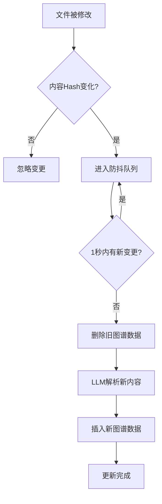
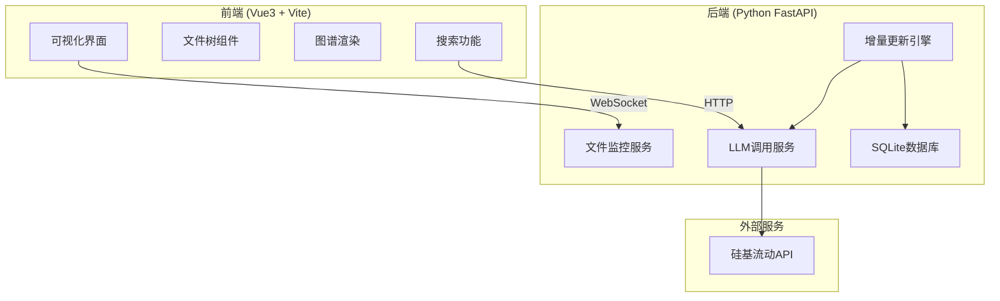
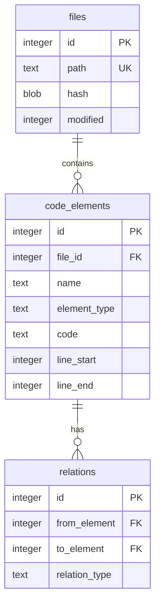

# 动态更新版ArkTS→SQLite代码知识图谱 PRD文档

## 1. 产品概述

### 一句话核心价值
改完代码0.5秒后，AI就能查到最新内容。不用等8分钟重新解析整个项目。

### 产品定位
基于第一性原理的增量代码知识图谱系统，专为ArkTS/TypeScript项目设计，通过智能增量更新实现近乎实时的代码语义索引。

### 目标用户
- ArkTS开发者
- 需要代码语义搜索能力的AI助手
- 大型TypeScript/ArkTS项目团队

### 解决的问题
- 传统方案改一行代码也要重新解析整个项目（100万行代码需要8分钟）
- 开发过程中代码持续变化，图谱永远是旧的
- 用户修改代码后最多愿意等2秒

---

## 2. 核心功能

### 2.1 核心算法（基于第一性原理）

**3个不可反驳的事实：**
1. 99%的代码修改只涉及1-2个文件
2. 一个文件的变更，只会影响这个文件里的代码
3. 用户改完代码，最多愿意等2秒

**3条铁则：**
1. **只改变了的**：哪个文件改了，就只更新哪个文件的图谱数据
2. **删了再加**：更新一个文件 = 先删掉它的所有旧数据 + 再插入新数据
3. **等你停手再更**：连续打字时不更新，等你停手1秒后再更新

### 2.2 功能模块

| 模块名称 | 功能描述 |
|---------|---------|
| 文件监控 | 使用watchdog监控项目文件变化 |
| 增量更新 | 检测到文件变化后，只更新该文件的图谱数据 |
| 防抖机制 | 1秒防抖，连续编辑只触发一次更新 |
| LLM解析 | 使用硅基流动API解析ArkTS代码生成知识图谱 |
| SQLite存储 | 存储代码元素（函数、类、接口、变量等）及其关系 |
| 可视化展示 | Web界面展示代码图谱结构和关系 |

### 2.3 页面详情

#### 主仪表盘页面
- **实时状态卡片**：显示监控状态、文件数量、更新频率
- **代码图谱可视化**：交互式展示代码结构关系
- **文件树列表**：项目文件导航，支持点击查看文件详情
- **搜索栏**：快速搜索代码元素（函数、类、变量等）
- **最近更新日志**：显示最近的代码变更和更新状态

#### 搜索结果页面
- **搜索结果列表**：显示匹配的代码元素
- **上下文预览**：显示代码片段及周围上下文
- **跳转链接**：点击跳转到源文件

---

## 3. 核心流程

### 3.1 文件变更检测流程

### 3.2 增量更新核心逻辑

---

## 4. 用户界面设计

### 4.1 设计风格

**设计理念**：深邃科技感 + 极简主义
- 深色主题为主，突出代码和专业感
- 霓虹色点缀，模拟终端/黑客风格
- 网格背景增加科技氛围

**配色方案**：
- 主色：#00ff88（科技绿）
- 次色：#0ea5e9（天蓝）
- 强调色：#f472b6（霓虹粉）
- 背景色：#0a0a0f（深空黑）
- 文字色：#e2e8f0（银白）

**字体**：
- 标题：JetBrains Mono（代码感）
- 正文：Noto Sans SC（中文可读性）

**动效**：
- 页面加载：渐入 + 轻微上移
- 交互反馈：微妙的发光效果
- 图谱节点：悬停放大 + 连接线高亮

### 4.2 页面布局

| 页面 | 布局 | 核心元素 |
|-----|------|---------|
| 主仪表盘 | 左右分栏 | 左侧：文件树 + 统计；右侧：图谱可视化 |
| 搜索页面 | 全宽列表 | 搜索框 + 结果列表 + 分页 |

### 4.3 响应式策略
- 桌面优先设计
- 平板适配：单栏布局
- 移动端：简化展示，提供核心功能

---

## 5. 技术架构

### 5.1 系统架构

### 5.2 数据库设计

---

## 6. API接口设计

### 6.1 REST API

| 接口 | 方法 | 描述 |
|-----|------|-----|
| /api/status | GET | 获取服务状态 |
| /api/files | GET | 获取文件列表 |
| /api/files/{id}/elements | GET | 获取文件代码元素 |
| /api/search | GET | 搜索代码元素 |
| /api/elements/{id} | GET | 获取元素详情 |
| /api/watch/start | POST | 启动监控 |
| /api/watch/stop | POST | 停止监控 |

### 6.2 WebSocket

| 事件 | 方向 | 描述 |
|-----|------|-----|
| file_changed | Server→Client | 文件变更通知 |
| update_progress | Server→Client | 更新进度 |
| update_complete | Server→Client | 更新完成 |

---

## 7. 性能指标

| 场景 | 预期耗时 |
|-----|---------|
| 修改一个普通文件 | 0.3秒 |
| 修改一个大组件文件 | 0.8秒 |
| 拉取10个文件的代码 | 2秒 |
| 首次运行全量解析100万行 | 8分钟 |
