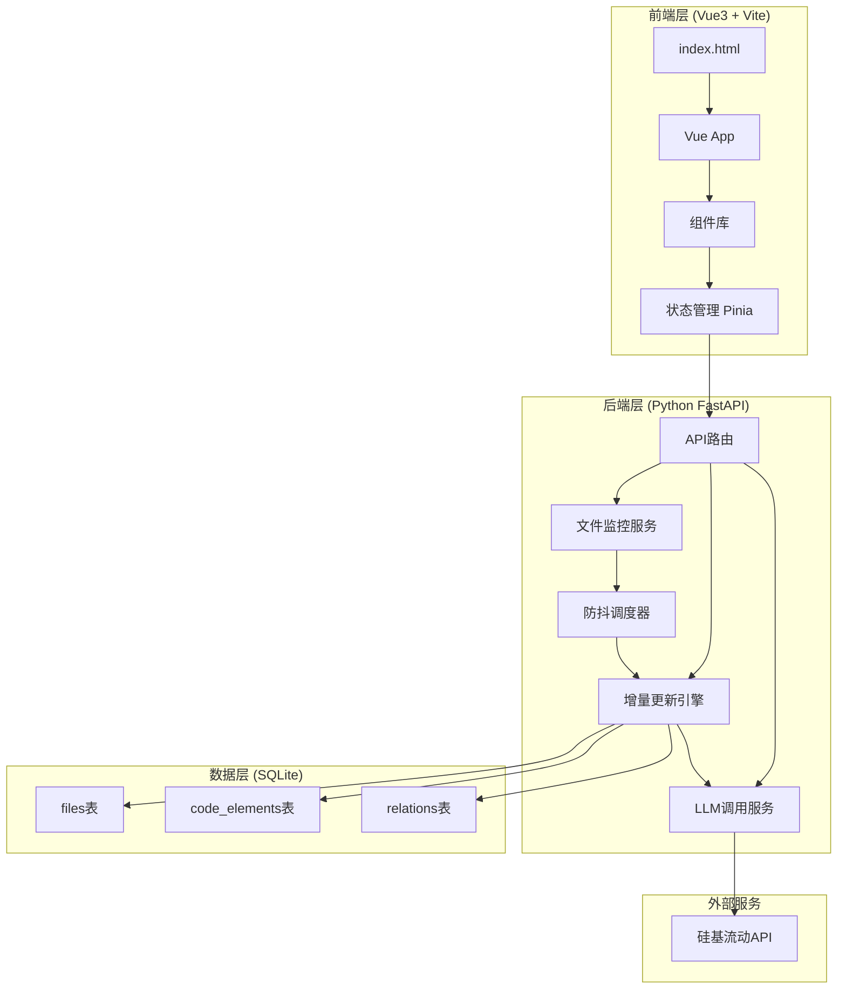
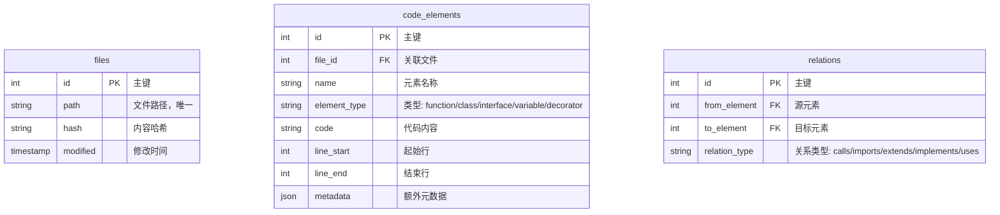
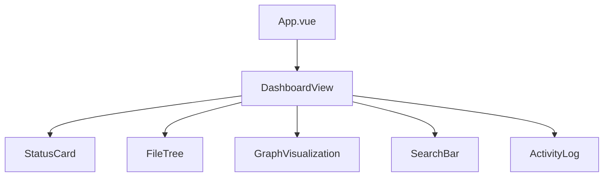

# 动态更新版ArkTS→SQLite代码知识图谱 技术架构文档

## 1. 架构设计

### 1.1 系统架构图



### 1.2 技术栈

| 层级 | 技术选型 |
|-----|---------|
| 前端框架 | Vue3 + Composition API |
| 构建工具 | Vite |
| 状态管理 | Pinia |
| 图表渲染 | D3.js / Force Graph |
| 后端框架 | FastAPI |
| 数据库 | SQLite |
| 文件监控 | watchdog |
| LLM调用 | requests (硅基流动API) |
| WebSocket | fastapi.websockets |

---

## 2. 技术实现细节

### 2.1 后端模块说明

#### 2.1.1 文件监控服务 (FileWatcher)
- 使用 watchdog 库监控项目目录
- 支持 .ts, .ets, .tsx 文件类型
- 事件类型：文件创建、修改、删除

#### 2.1.2 防抖调度器 (DebounceScheduler)
- 1秒防抖机制
- 合并连续的文件变更事件
- 维护待处理队列

#### 2.1.3 增量更新引擎 (IncrementalUpdater)
- **删除阶段**：删除指定文件的所有旧数据（files、code_elements、relations）
- **解析阶段**：调用LLM解析文件内容
- **插入阶段**：将新数据插入数据库
- **哈希更新**：更新文件表的hash字段

#### 2.1.4 LLM调用服务 (LLMService)
- 调用硅基流动API
- 提示词工程：设计专门解析ArkTS代码的prompt
- 解析输出：函数、类、接口、变量、导入关系等

### 2.2 数据库设计

#### 2.2.1 数据模型 (ER图)



#### 2.2.2 DDL语句

```sql
CREATE TABLE files (
    id INTEGER PRIMARY KEY AUTOINCREMENT,
    path TEXT UNIQUE NOT NULL,
    hash TEXT NOT NULL,
    modified TIMESTAMP DEFAULT CURRENT_TIMESTAMP
);

CREATE TABLE code_elements (
    id INTEGER PRIMARY KEY AUTOINCREMENT,
    file_id INTEGER NOT NULL,
    name TEXT NOT NULL,
    element_type TEXT NOT NULL,
    code TEXT NOT NULL,
    line_start INTEGER NOT NULL,
    line_end INTEGER NOT NULL,
    metadata TEXT DEFAULT '{}',
    FOREIGN KEY (file_id) REFERENCES files(id) ON DELETE CASCADE
);

CREATE TABLE relations (
    id INTEGER PRIMARY KEY AUTOINCREMENT,
    from_element INTEGER NOT NULL,
    to_element INTEGER NOT NULL,
    relation_type TEXT NOT NULL,
    FOREIGN KEY (from_element) REFERENCES code_elements(id) ON DELETE CASCADE,
    FOREIGN KEY (to_element) REFERENCES code_elements(id) ON DELETE CASCADE
);

CREATE INDEX idx_elements_file ON code_elements(file_id);
CREATE INDEX idx_elements_type ON code_elements(element_type);
CREATE INDEX idx_relations_from ON relations(from_element);
CREATE INDEX idx_relations_to ON relations(to_element);
```

---

## 3. API接口定义

### 3.1 状态接口

```
GET /api/status

Response:
{
  "watching": true,
  "file_count": 42,
  "element_count": 1250,
  "last_update": "2024-01-15T10:30:00Z"
}
```

### 3.2 文件列表接口

```
GET /api/files

Response:
{
  "files": [
    {
      "id": 1,
      "path": "/src/pages/Index.ets",
      "element_count": 15,
      "modified": "2024-01-15T10:30:00Z"
    }
  ]
}
```

### 3.3 文件详情接口

```
GET /api/files/{id}/elements

Response:
{
  "file": {
    "id": 1,
    "path": "/src/pages/Index.ets"
  },
  "elements": [
    {
      "id": 1,
      "name": "buildLabel",
      "element_type": "function",
      "line_start": 10,
      "line_end": 15
    }
  ]
}
```

### 3.4 搜索接口

```
GET /api/search?q={query}&type={type}

Response:
{
  "results": [
    {
      "id": 1,
      "name": "buildLabel",
      "element_type": "function",
      "file_path": "/src/pages/Index.ets",
      "code_preview": "buildLabel(): string { ... }"
    }
  ]
}
```

### 3.5 监控控制接口

```
POST /api/watch/start
POST /api/watch/stop
```

### 3.6 WebSocket事件

```javascript
// 文件变更事件
{
  "type": "file_changed",
  "data": {
    "path": "/src/pages/Index.ets",
    "action": "modified"
  }
}

// 更新进度事件
{
  "type": "update_progress",
  "data": {
    "path": "/src/pages/Index.ets",
    "progress": 50
  }
}

// 更新完成事件
{
  "type": "update_complete",
  "data": {
    "path": "/src/pages/Index.ets",
    "element_count": 15,
    "duration_ms": 320
  }
}
```

---

## 4. LLM提示词设计

### 4.1 ArkTS代码解析提示词

```
你是一个专业的ArkTS/TypeScript代码分析助手。请分析以下代码，提取所有代码元素和它们之间的关系。

输出格式要求：
1. 函数（function）
2. 类（class）
3. 接口（interface）
4. 装饰器（decorator）
5. 变量声明（variable）
6. 导入关系（imports）

对于每个元素，请提供：
- 元素类型
- 名称
- 代码内容
- 行号范围
- 依赖关系

请以JSON格式输出。
```

---

## 5. 前端组件设计

### 5.1 组件树



### 5.2 核心组件

| 组件 | 功能 |
|-----|------|
| StatusCard | 显示监控状态、统计数据 |
| FileTree | 项目文件树导航 |
| GraphVisualization | 代码图谱交互式可视化 |
| SearchBar | 代码元素搜索 |
| ActivityLog | 最近更新日志 |

---

## 6. 部署架构

### 6.1 项目结构

```
/workspace
├── backend/
│   ├── main.py
│   ├── api/
│   ├── services/
│   ├── models/
│   └── database/
├── frontend/
│   ├── src/
│   ├── public/
│   └── package.json
├── data/
│   └── knowledge_graph.db
└── docs/
```

### 6.2 启动流程

1. 启动后端：`cd backend && python main.py`
2. 启动前端：`cd frontend && npm run dev`
3. 访问前端页面
4. 选择监控目录
5. 系统开始监控并增量更新
